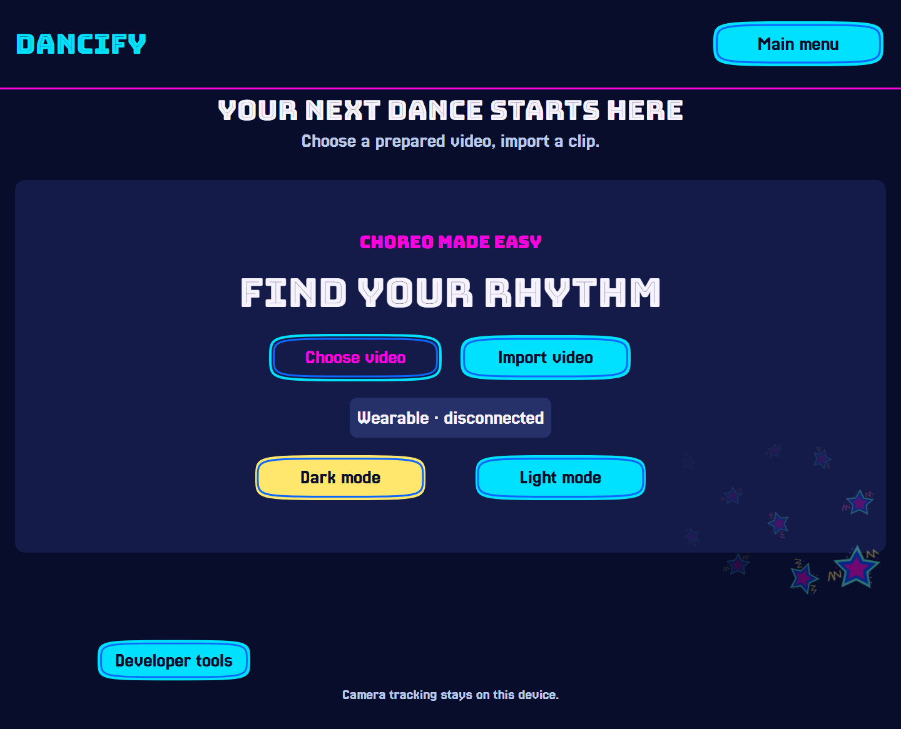
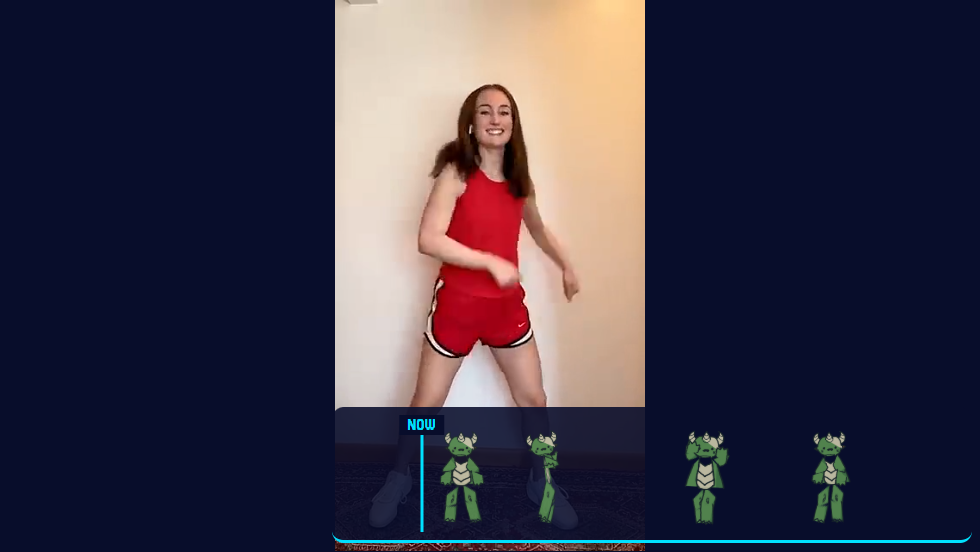
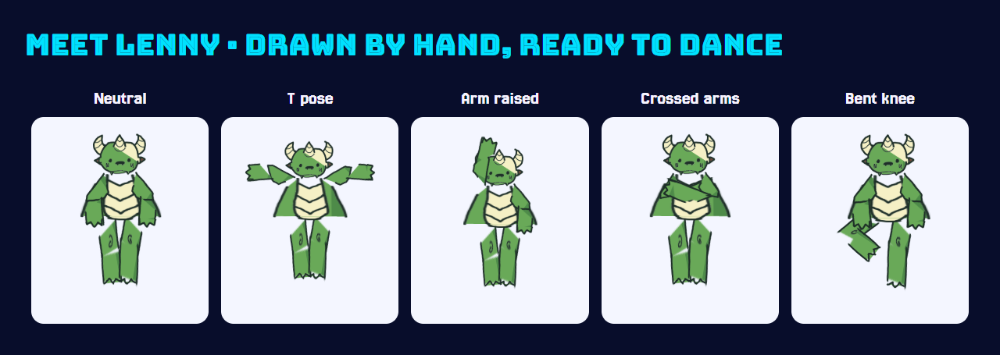
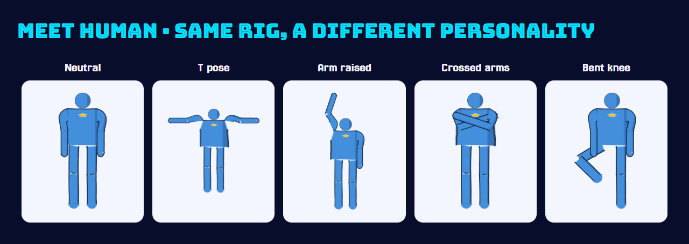

<div align="center">

# 🎶 Dancify

**Your video. Your moves. Your moment.**

A webcam dance game with hand-drawn characters and a roller-rink heart.

[See it in action](#-on-the-dance-floor) · [Meet the characters](#-drawn-by-hand-ready-to-dance) · [Try it locally](#-try-it-locally) · [Our stack](#-under-the-hood)

</div>



## 💃 On the dance floor

We wanted to turn watching a dance into joining in. Dancify takes a short, supported solo dance clip, prepares its music timing and target poses, and brings it into a playful browser game. Pick a video, press **Start dance**, and jump in after **3–2–1**.

- **See the next move coming.** Our pictographs slide toward a fixed **NOW** marker, with a six-second preview synchronized to the reference video.
- **Dance with your webcam.** Pose inference runs locally in the browser. The current demo compares shoulders, elbows, and wrists, so legs can stay out of frame.
- **Make it your dance floor.** Choose Lenny or Human, switch between light and dark themes, and use the large, custom-styled controls.
- **Keep your favorites.** Prepare clips once, replay them from the song library, and delete songs with a confirmation step.
- **Finish with a celebration.** Custom star artwork, a milestone cue, and win music bring the results screen to life.



*Captured from the running reference player, paused at three seconds. The camera was off for this screenshot; it illustrates the cue strip, not a measured player result.*

## 🎨 Drawn by hand, ready to dance

**We hand-drew our pictographs.** Lenny and Human begin as original character parts, then become an articulated paper-doll rig. The renderer places those parts against a checkpoint's pose landmarks, giving each move its own illustrated target.

Each character uses 14 small runtime sprites. Joint pivots, attachment points, layering, and color palettes let us reuse the original linework across different poses. If artwork cannot load or a pose cannot be drawn reliably, a skeleton provides the fallback.





*Character galleries rendered from the actual game assets using five diagnostic poses, with a documentation layout. These are illustrations, not scored rounds.*

Explore the [original artwork and rig](assets/pictograms/), [runtime renderer](web/src/pictograms/rig.ts), and [art integration notes and provenance](docs/handoffs/pictogram-integration.md).

## 🛠 Under the hood

| Part | Technology | What it does |
| --- | --- | --- |
| Game and interface | React, TypeScript, Vite | Menus, library, countdown, gameplay, sliding pictographs, and results |
| Webcam tracking | MediaPipe Pose | On-device body landmarks and upper-body pose comparison |
| Video preparation | Python, OpenCV, NumPy, SciPy | Track the reference dancer, smooth landmarks, and build checkpoint poses |
| Music and media | librosa, FFmpeg, yt-dlp | Analyze beats, process media, and acquire supported URL inputs |
| Local song cache | FastAPI, SQLAlchemy, SQLite | Store prepared bundles, song metadata, and play history |
| Character art and UI | Hand-drawn PNG parts, SVG rendering, Figma | Our two characters, custom controls, fonts, and star artwork |
| Wearable prototype | ESP32-S3, Arduino C++, FreeRTOS, Web Bluetooth | Optional rotary/button input and buzzer feedback |
| Development checks | Vitest, Playwright, pytest | Unit, browser, and Python checks across the project |

### How a clip becomes a game

1. **Import:** upload a short clip or provide a supported video URL.
2. **Prepare:** analyze the reference video and audio, then cache a video/chart/audio bundle.
3. **Play:** read the reference video's time to position the cues and open each scoring window.
4. **Compare:** score the best valid webcam pose within each checkpoint window.
5. **Celebrate:** show results immediately while local history saves in the background.

Camera frames stay in the browser. Preparation and the song cache run on the same computer; gameplay does not depend on cloud inference.

## 💡 What we learned

- **One clock keeps everything together.** Using the reference video's `currentTime` keeps pictographs, scoring windows, pause, and replay aligned.
- **A visible person is not automatically a valid match.** Coordinate normalization, aspect ratios, mirroring, and landmark confidence matter. Missing tracking needs its own outcome.
- **Art needs engineering, too.** Hand-drawn parts need calibrated pivots, sensible layer order, and controlled stretching to remain recognizable in different poses.
- **Connection is only the first hardware milestone.** Flashing firmware and seeing a BLE advertisement do not prove that a knob press reaches the UI. End-to-end input still needs work.
- **A good demo needs a clear way to start.** Manual Start, a predictable countdown, and relaxed framing make the experience easier to demonstrate.

## 🚀 Try it locally

**Prerequisites:** Ubuntu/WSL2, Python **3.10–3.12**, Node.js **22.12+**, FFmpeg, and a desktop Chrome or Edge browser. Follow the [setup guide](LAUNCHER.md) for system packages and Windows instructions.

From your cloned repository in Ubuntu/WSL2:

```bash
bash scripts/setup.sh
bash scripts/start.sh
```

The launcher opens the app at **http://127.0.0.1:5173** and starts the local API. On Windows, the equivalent entry points are **Setup Dancify.cmd** and **Start Dancify.cmd**.

For a quick walkthrough:

1. Import a short, stable, solo-dancer clip with music and wait for preparation to finish.
2. Choose it from the library and allow camera access.
3. Press **Start dance** and follow the **3–2–1** countdown.
4. Watch the upcoming pictographs and keep your shoulders, elbows, and wrists visible.
5. Finish the round, celebrate, and choose **Play again**.

The wearable is optional. [Firmware and wiring instructions](firmware/README.md) cover the ESP32-S3 prototype.

### Hackathon demo status

- **Current preparation scope:** short, stable, solo-dancer clips with constant frame rate. Multi-person tracking and continuous choreography scoring are future work.
- **Promo results:** the current build intentionally displays **five stars on every completed round** for promotional capture. Raw scores, accuracy, and tracking data remain measured. Set `PROMO_FIVE_STAR_RESULTS` to `false` in [GamePanel.tsx](web/src/components/GamePanel.tsx) to restore normal star ratings.
- **Wearable:** production-board firmware was uploaded and BLE advertising was verified. Knob/button control in the app is still unresolved; the demo uses mouse controls.
- **Next steps:** restore measured star presentation after the promo, finish wearable input validation, and refine camera calibration and character posing with more users.

## Find your way around

| Folder | Contents |
| --- | --- |
| [`web/`](web/) | Browser game, audio, camera tracking, and character renderer |
| [`pipeline/`](pipeline/) | Reference-video preparation |
| [`backend/`](backend/) | Local API, cache, and play history |
| [`firmware/`](firmware/) | ESP32-S3 wearable |
| [`assets/pictograms/`](assets/pictograms/) | Original hand-drawn character parts and rig |
| [`schema/`](schema/) | Shared chart contracts |
| [`docs/`](docs/) | Design notes, handoffs, and screenshots |

[Design guide](design.md) · [Product vision](PRD.md.md) · [Gameplay contract](docs/handoffs/gameplay-integration-contract.md) · [Screenshot notes](docs/screenshots/README.md)

---

**Built for the hackathon, with a little rhythm and a lot of hand-drawn personality.**
