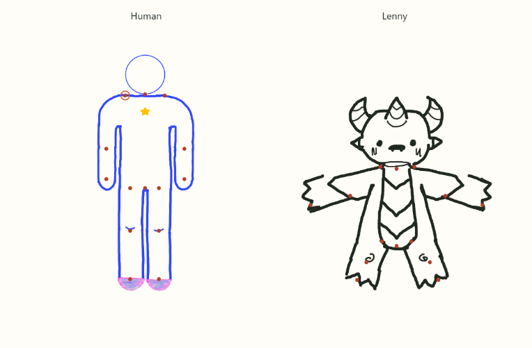
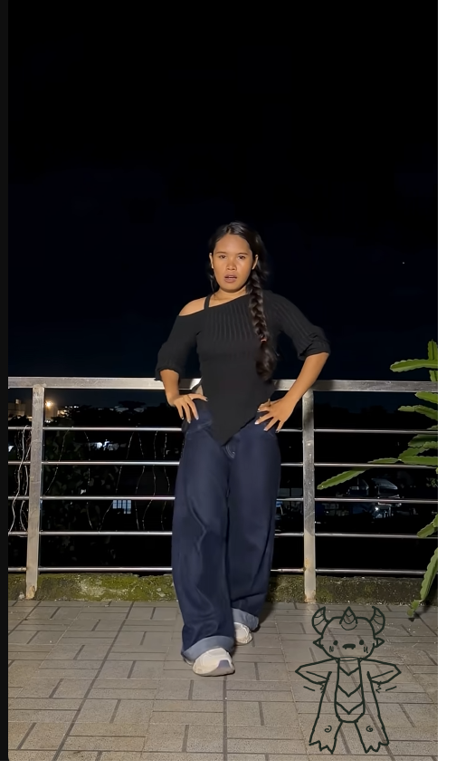

# Gameplay example with articulated pictograms

[Open the interactive example](gameplay-example.html).



The example assembles Human and Lenny from the original transparent PNGs using `assets/pictograms/rig.json` and `rig.mjs`. Joint markers show the authored attachment points. Select a character and joint, then rotate it to see its child parts follow. Hand choices switch between open, fist, and pointed drawings. Selecting Lenny's side profile replaces both the face and torso while retaining their neck and root attachments.

## Run locally

From the repository or extracted package root:

```sh
python -m http.server 8000 --bind 127.0.0.1
```

Open `http://127.0.0.1:8000/docs/design/gameplay-example.html`. The module, manifest, and PNGs are loaded from that local server. Opening the HTML directly with `file://` may fail because browsers restrict module and JSON loading from local files.

## Review and adjust calibration

Choose a joint and edit its sprite pivot X/Y in full source pixels. The example redraws immediately and shows normalized coordinates. Download the edited rig to retain calibration; edits are not automatically written back to repository files. Reset pose clears the selected character's rotations; it preserves pivot edits and alternative choices.

The manifest separately stores child attachments in parent coordinates. When moving a joint on a parent drawing, update those attachments as well as the child's registration pivot. See [the complete pictogram README](../../assets/pictograms/README.md) for coordinates, hierarchy, filename mappings, and application integration.

## Original reference



[Editable Gameplay Template page](https://www.figma.com/design/NpYrJzwvI4CBLv3ogzDW5g/Dance-Pictogram-Assets?node-id=12-27).

The original 504 × 850 `gameplay-example.png` is retained unchanged as a visual reference. The supplied link identifies the Gameplay Template page, not an enclosing frame. Its Lenny torso, face, upper arms, knees, lower legs, and feet use 115 × 115 layers at (15, 94); fists use a 55 × 55 layer at (45, 134). The authored rig replaces these ad hoc placements with explicit source pivots and parent attachments.

`gameplay-pivots.png` is a screenshot of the implemented renderer's neutral assemblies. `gameplay-example.html` is the updated interactive example. No Figma canvas changes were made.

## Validation and integration boundary

Eight automated tests pass for attachment preservation during combined rotations, independent limbs, alternative swaps, normalized pivots, all 23 asset paths, invalid input, and asset-load errors. Browser checks pass for rotation controls, all hand choices, Lenny's profile swaps, pivot editing, and edited JSON generation, with no JavaScript errors. Neutral and articulated states were visually inspected.

The example is a rig demonstration, not the live game's playback or scoring UI. It contains no separate animation clock or webcam access. Integrate `drawRig` into the existing video-driven render loop as a subsequent application change. Newly calibrated coordinates should receive artist review for motion aesthetics before that integration.
